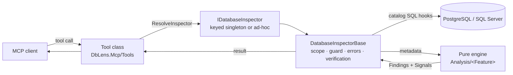
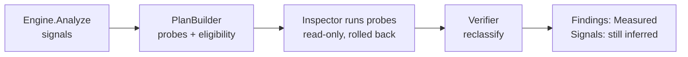

# Architecture

## Projects

```
DbLens.Core        interfaces, models, pure analysis engines, DatabaseInspectorBase   (no DB driver)
DbLens.Postgres    PostgresInspector  : DatabaseInspectorBase                          (Npgsql)
DbLens.SqlServer   SqlServerInspector : DatabaseInspectorBase                          (Microsoft.Data.SqlClient)
DbLens.EfCore      SnapshotReader: an EF Core snapshot read as C# text with Roslyn         (no build)
DbLens.Docs        ProjectInventory of a .NET solution, from syntax only: pure engines + SolutionReader (no DB, no build)
DbLens.Mcp         MCP server: Program.cs, tools, DI wiring
DbLens.Tests       xUnit: pure engine tests + integration tests against both demo databases
```

## A call, end to end



1. A tool (`[McpServerToolType]`, derived from `InspectorTool`) turns MCP parameters into a request.
2. `InspectorTool.ResolveInspector` picks the keyed singleton for the dialect, or builds an ad-hoc
   inspector when the call carries its own `connectionString`.
3. `DatabaseInspectorBase` resolves the table scope, reads catalog metadata through the dialect's
   hooks, and wraps every `DbException` in a `DatabaseInspectionException`.
4. A **pure engine** in `Analysis/<Feature>/` turns metadata into findings. Engines never touch a
   connection, so every rule is unit-tested without a database.
5. The base appends caveats (scope, `NotFound`, truncation) and returns.

## The dialect line

`DatabaseInspectorBase` (`DbLens.Core/Inspection/`) is built on `System.Data.Common`, so Core needs
no driver. It owns everything that does not depend on SQL dialect:

| Base owns | Dialect supplies |
|---|---|
| scope resolution | `CreateConnection`, `DialectDisplayName`, `DefaultSchema` |
| `DbException` wrapping, scope and `NotFound` caveats | — |
| the schema overview: grouping, totals, summary | `QueryOverviewAsync`: the overview rows |
| reading a requested name (`ParseTableNames`), assembling table details | `ReadTableCatalogAsync`: the catalog rows |
| the `explain_query` statement guard | `FetchQueryPlanAsync` (after the guard has run) |
| orchestration of every diagnostic tool; the cascade graph, built from the table details | `IndexUsageCommand`, `QueryFragmentationStatsAsync` |
| unused columns and audit dates: rules, EF fixes, verification | `ColumnStatisticsCommand` (planner statistics, no values), `TableUpdatesCommand` |
| the heaviest queries: ranking, redaction, rules, join fan-out | `HotQueryCommandsAsync` (the source's commands, or why there is none), `PlanHotQueryAsync` (a stored or generic plan) |
| when the scan counters started (`StatsWindow`: the latest of server start, creation, restore, reset) | `StatsWindowCommandAsync`: days since each event |
| connections, commands, row mapping, rolled-back transactions (`OpenAsync`, `Command`, `ReadAllAsync`, `InRolledBackTransactionAsync`) and reading a column by name (`DbReading`) | SQL text and typed parameters |
| the signal verification loop | `VerificationSetupSql`, `ClassifyVerificationError`, `VerificationCaveats` |
| join evidence: parsing, filtering own probes | `QuerySqlSourcesAsync` — views, routines, pg_stat_statements / Query Store |
| `query_with_receipt` and its cross-check | `ReadOnlyQuerySetupSql`, `ReceiptCaveats` |
| the read-only-login refusal, and whether a server is local (`LocalServer`) | `DescribeWriteCapabilityAsync`, `ServerHosts` |

`scan_gdpr`, `analyze_denormalization`, `check_migration_safety`, `check_cascade_paths`,
`infer_relationships`, `build_glossary` and `compare_ef_model` need no catalog SQL of their own: they run on `TableDetail` metadata the base already
reads, plus the SQL sources.

## Analysis layout

```
DbLens.Core/Analysis/
  Finding.cs, Evidence.cs, Severity.cs, FindingCategory.cs   the result contract
  FindingSplit.cs        partitions facts and signals, owns the 200-finding cap, summary dictionaries
                         and the caveat that explains Signals
  DiagnosticLimits.cs    the 200-finding cap and the 20-table limit of get_table_details
  SqlProposal.cs         SQL attached to a finding: Ddl or ReadOnlyProbe
  SqlIdentifier.cs       quoting for every generated identifier
  SqlText.cs             per-dialect lexer: code, comments, literals, quoted names; statement splitting
  Num.cs                 locale-invariant number formatting for finding text
  RuleIds.cs             every rule ID constant
  TableDetailExtensions.cs  table and index helpers the engines share (qualified name, key columns, index order)
  Verification/          probe, budget, measurement and outcome types shared by verifying tools
  Relationships/         undeclared-FK rule, JoinPredicateExtractor (joins in SQL text), engine
  Receipts/              receipt models, ResultComparer (cross-checks), ResultValue
  Glossary/              GlossaryEngine: the SKILL.md data map
  Hygiene/               HygieneEngine (column and audit rules, checks, reclassification), audit_columns.json
  HotQueries/            HotQueryEngine (ranking, figures, rules), JoinFanOut (shape, probe, reclassification)
  EfCore/                EfModel (a snapshot's model), EfModelMatcher (entity ↔ table, property ↔ column),
                         EfDriftEngine (compare_ef_model)
  Indexes/ Gdpr/ Cascade/ Denormalization/ Fragmentation/ QueryPlan/ Migration/
```

## Signal verification pipeline

Three phases; only the middle one touches a database.



- `DenormalizationAnalysisEngine` / `RelationshipAnalysisEngine` / `JoinFanOut` / `HygieneEngine` produce
  signals — pure. A probe carries the rows it needs and, for a share, the share that confirms it.
- The plan builder turns verifiable signals into `VerificationProbe`s; `VerificationBudget.Evaluate`
  decides which may run (query cap, table size, unknown row count) — pure.
- `DatabaseInspectorBase.RunVerificationProbesAsync` executes them, one rolled-back transaction each.
- `DenormalizationVerifier` / `RelationshipAnalysisEngine.ApplyVerification` reclassify — pure. Both
  attach the outcome with `VerificationOutcome.Attach` and explain what did not run with
  `VerificationBudget.NotRunCaveats`, so the two tools cannot report the same measurement differently.
  The wording of a confirmation or refutation is the tool's own.

See [safety.md](safety.md#signal-verification) for the guarantees.

## EF Core models

`compare_ef_model` takes an EF Core model the tool reads from disk before the inspector sees it:

1. `SnapshotReader` (`DbLens.EfCore`) parses `*ModelSnapshot.cs` with Roslyn — syntax only, nothing
   compiled or loaded — into an `EfModel`: entities with their resolved tables, properties → columns,
   keys, indexes, relationships, and the migration ids of the `*.Designer.cs` files of the same
   DbContext. Owned types and TPH subtypes are folded into the table they share, with the nullable
   columns EF gives them; mappings it does not compare go into `Unsupported`.
2. `DatabaseInspectorBase.CompareEfModelAsync` reads the tables of the schemas the model maps and the
   history table, found by name in the schema overview and read with quoted identifiers.
3. `EfModelMatcher` pairs entities with tables and properties with columns; `EfDriftEngine` turns the
   pairs into findings — both pure.

Roslyn stays out of Core: only `DbLens.Mcp` and `DbLens.Docs` reference `DbLens.EfCore`. The test snapshots under
`tests/DbLens.Tests/Fixtures/EfSnapshots/ef{8,9,10}` are written by the real `dotnet ef` of each major
from `samples/DemoShop.EfCore` (`scripts/generate-ef-fixtures.sh`), because the snapshot format may
change between versions; the fixtures are copied to the test output and never compiled. The same
script copies the EF Core 10 migrations into the sample (`Migrations/<provider>`, history in `shop`),
so `dotnet ef migrations script` runs there, and writes the first migration's SQL into the demo's
`shop` schema (`db/<dialect>/04-shop.sql`), above the drift that file keeps by hand. The EF
integration tests build `dblens_ef` from that file and `dblens_ef_clean` (every migration, no drift)
from the SQL those same tools wrote.

## Project inventory (DbLens.Docs)

`DbLens.Docs` lists what a solution has to document, read from syntax only — see
[docs/roadmap/docs-m1.md](roadmap/docs-m1.md) and the permission it asks for in
[safety.md](safety.md#dblensdocs-reads-source-code).

1. `SolutionReader` is the only code that touches a folder: it returns the files (relative paths with
   `/`, ordered), the EF models its `SnapshotReader` read, and what it could not read.
2. `ProjectInventoryEngine.Build` is pure: the same files in any order give the same
   `ProjectInventory`. Its extractors (`ProjectExtractor`, `EntityExtractor`, `EndpointExtractor`,
   `ConfigExtractor`, `HttpClientExtractor`, `HostedServiceExtractor`) each return items and coverage notes.
3. Every item has a stable id (`project:`, `entity:`, `endpoint:`, `config:`, `http:`, `hosted:`), a source
   file and line, an evidence (`Extracted`, or `Unresolved` with its reason) and sorted attributes.
   `InventoryJson` writes it without a clock or an absolute path.

The tests read a trimmed `dotnet/eShop` (`tests/DbLens.Tests/Fixtures/Docs/eShop`) and the repository's
`samples/DemoShop.EfCore`, and compare the result with `tests/DbLens.Tests/Docs/Reference/*.inventory.json`
(refreshed with `DBLENS_UPDATE_DOCS_REFERENCE=1`).

## Server layer

`DbLens.Mcp` holds what is not about databases:

- `InspectorTool` — the base of every database tool: resolves the inspector for a call (the keyed
  singleton, or an ad-hoc one for a caller's `connectionString`) and holds the parameter descriptions
  the tools share.
- `DatabaseInspectorFactory` — builds an inspector for a dialect and connection string, applying the
  server policy. Behind an interface so the tool tests can substitute it.
- `ServerPolicy` — operator settings that change the contract (`AllowQueryResults`,
  `AllowWriteCapableLogin`, `ReadOnlyLoginOnLocalhost`). Configuration only; never a tool parameter a
  model could set.
- `CertifiedQueryStore` — the certified queries, one local JSON file.
- `ToolErrors` — a call-tool filter. The SDK hides exception messages; this one turns
  `ArgumentException`, `ExecutionRefusedException` and `DatabaseInspectionException` into readable tool
  errors so the model sees *why* a call was refused.

## Testing

- **Engine tests** build metadata in memory with `TestSchema` and need no database.
- **Integration tests** are written once in an abstract `<Feature>TestsBase(IDatabaseFixture)` and
  derived for PostgreSQL and SQL Server.
- **Parity tests** run the same analysis on both dialects and compare findings; genuine differences
  (SQL Server rejects a self-referencing `ON DELETE CASCADE`) are asserted as differences.
- Integration tests **skip, never pass**, when a database is unreachable, and CI fails on any skip.
- **Edge-catalog tests** (`EdgeCatalogTestsBase`) run against a `dblens_edge` database their fixture
  creates and drops: names with dots or differing only in case, partial and covering indexes, views,
  partitioned tables. Shapes the demo schema lacks go there, not into `db/*/01-schema.sql`, whose
  object counts the other tests assert.
- **Composition tests** (`CompositionTestsBase`) feed one tool's output to another: the constraint
  `infer_relationships` proposes and the index `analyze_indexes` proposes must be recognized — and not
  flagged — by `check_migration_safety`, like the script of the demo's pending EF migrations, whose
  drop must be flagged; a verification probe must pass `explain_query` and reproduce
  its counts through `query_with_receipt`; the glossary must list every path of the relationship map.
- Integration tests connect as `dblens_reader`; the admin login (`DBLENS_TEST_*_ADMIN_CONNECTION`) is
  used for setup, to show that a local server is exempt from the read-only-login check, and — with
  `ReadOnlyLoginOnLocalhost` — that a write-capable login is refused.
- `demo_good` is the acceptance schema: every diagnostic tool must report nothing there except its
  always-present summary finding.

## Code style

`.editorconfig` holds the C# rules, and the build enforces them: with `EnforceCodeStyleInBuild` and
`TreatWarningsAsErrors`, a rule at `warning` is a build error. File-scoped namespaces, `is null`,
collection expressions, primary constructors, tuple deconstruction and the `I` prefix are at
`warning`; the rest is at `suggestion` until the code complies. `dotnet format style dblens.slnx`
applies the fixes. A rule moves to `warning` only once the build is clean with it.

## Demo databases

`docker compose up -d` starts PostgreSQL 17 on port 5433 and SQL Server 2022 on 1434, initialized
from `db/<dialect>/01-schema.sql`, `02-seed.sql`, `03-reader.sql` and `04-shop.sql`, in that order.

| Schema | Content |
|---|---|
| `public` / `dbo` | An e-commerce schema with deliberate flaws: unindexed FKs, plaintext PII, cascade chains, cached aggregates, undeclared references on `shipments` — `ship_to` visible only through the `shipment_destinations` view — and comments on `orders` for the glossary |
| `demo_good` | A clean design every tool should pass |
| `shop` | The EF Core model of `samples/DemoShop.EfCore` at its first migration, empty, then drifted by hand: a column and a foreign key dropped, an index and a table added, a column narrowed, one made nullable, a unique index made plain, and a hotfix row in `shop.__EFMigrationsHistory`. Two migrations are pending, the second a `DROP COLUMN` |

Seed row counts are deterministic: `users` 20, `products` 30, `orders` 40, `order_items` 80,
`payments` 35, `item_reviews` 20, `addresses` 20, `audit_logs` 100, `customer_profiles` 10,
`profile_notes` 5, `shipments` 6, `categories` 4.

`03-reader.sql` creates `dblens_reader`, the read-only login dblens connects with by default.

Volumes hold demo data only; `docker compose down -v && docker compose up -d` recreates them.
`04-shop.sql` is written by `scripts/generate-ef-fixtures.sh` above its `-- Drift` line.

## Releases

Pushing a `v*` tag runs `.github/workflows/release.yml`, and so does running it by hand with a
`version` input, which tags the commit it built. The version comes from the tag or the input
(`v0.4.0` → `0.4.0`) and is stamped into the package and `.mcp/server.json`; keep `<Version>` in
`DbLens.Mcp.csproj` and `server.json` in step anyway, so a local build reports the same number. The
workflow runs engine tests, then builds self-contained single-file
binaries for `win-x64`, `linux-x64` and `osx-arm64`, one Claude Desktop extension per platform
(`.mcpb`, from `packaging/mcpb/manifest.json`), the NuGet tool package (`dotnet tool install -g
DbLens.Mcp`, also typed `McpServer` with `.mcp/server.json`), and the GitHub release. Binaries ship
without symbols, `web.config` or the IIS module.

The Claude Code plugin (`plugins/dblens`) has no artifact of its own: the marketplace at the
repository root installs it from `master`, and it starts `DbLens.Mcp@<its version>` with `dnx`. Its
version moves with the package's (`ReleaseVersionTests`), and the release follows the merge at once.

The package reaches nuget.org through **Trusted Publishing**: the job's GitHub OIDC token is exchanged
by `NuGet/login@v1` for an API key valid one hour, so no long-lived key is stored. The package page
shows the README packed into the `.nupkg`, so its links must be absolute and a README change reaches
nuget.org only with the next release. One-time setup, already done for this repository:

1. On nuget.org, *Trusted Publishing* → new policy: owner `MatteoBelletti`, repository `dblens`,
   workflow file `release.yml` (file name only), no environment.
2. In the GitHub repository, add the secret `NUGET_USER` with the nuget.org **profile name** (not the
   e-mail address).

Without `NUGET_USER` the login and push steps are skipped and the `.nupkg` is still attached to the
release. A policy on a private repository stays provisional for 7 days until the first successful
publish.
