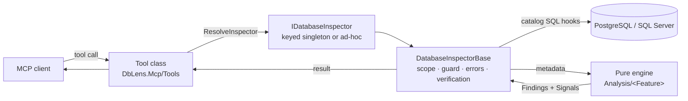
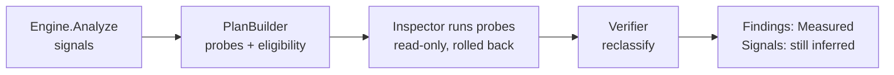

# Architecture

## Projects

```
DbLens.Core        interfaces, models, pure analysis engines, DatabaseInspectorBase   (no DB driver)
DbLens.Postgres    PostgresInspector  : DatabaseInspectorBase                          (Npgsql)
DbLens.SqlServer   SqlServerInspector : DatabaseInspectorBase                          (Microsoft.Data.SqlClient)
DbLens.Mcp         MCP server: Program.cs, tools, DI wiring
DbLens.Tests       xUnit: pure engine tests + integration tests against both demo databases
```

## A call, end to end



1. A tool (`[McpServerToolType]`, derived from `InspectorTool`) turns MCP parameters into a request.
2. `InspectorTool.ResolveInspector` picks the keyed singleton for the dialect, or builds an ad-hoc
   inspector when the call carries its own `connectionString`.
3. `DatabaseInspectorBase` resolves the table scope, reads catalog metadata through the dialect's
   hooks, and wraps every `DbException` in a `DatabaseInspectionException`.
4. A **pure engine** in `Analysis/<Feature>/` turns metadata into findings. Engines never touch a
   connection, so every rule is unit-tested without a database.
5. The base appends caveats (scope, `NotFound`, truncation) and returns.

## The dialect line

`DatabaseInspectorBase` (`DbLens.Core/Inspection/`) is built on `System.Data.Common`, so Core needs
no driver. It owns everything that does not depend on SQL dialect:

| Base owns | Dialect supplies |
|---|---|
| scope resolution and the 20-table limit | `CreateConnection`, `DialectDisplayName`, `DefaultSchema` |
| `DbException` wrapping, `NotFound` caveat | `GetSchemaOverviewAsync`, `GetTableDetailsAsync`, `TestConnectionAsync` |
| the `explain_query` statement guard | `FetchQueryPlanAsync` (after the guard has run) |
| orchestration of every diagnostic tool | `QueryIndexUsageStatsAsync`, `QueryFragmentationStatsAsync`, `QueryCascadeGraphAsync` |
| the signal verification loop | `VerificationSetupSql`, `ClassifyVerificationError`, `VerificationCaveats` |

`scan_gdpr`, `analyze_denormalization`, `check_migration_safety` and `infer_relationships` need no
dialect code at all: they run on `TableDetail` metadata the base already reads.

## Analysis layout

```
DbLens.Core/Analysis/
  Finding.cs, Evidence.cs, Severity.cs, FindingCategory.cs   the result contract
  FindingSplit.cs        partitions facts and signals, owns the 200-finding cap and summary dictionaries
  SqlProposal.cs         SQL attached to a finding: Ddl or ReadOnlyProbe
  SqlIdentifier.cs       quoting for every generated identifier
  SqlText.cs             comment stripping, literal blanking, statement splitting
  Num.cs                 locale-invariant number formatting for finding text
  RuleIds.cs             every rule ID constant
  Verification/          probe, budget, measurement and outcome types shared by verifying tools
  Indexes/ Gdpr/ Cascade/ Denormalization/ Fragmentation/ QueryPlan/ Migration/ Relationships/
```

## Signal verification pipeline

Three phases; only the middle one touches a database.



- `DenormalizationAnalysisEngine` / `RelationshipAnalysisEngine` produce signals — pure.
- The plan builder turns verifiable signals into `VerificationProbe`s; `VerificationBudget.Evaluate`
  decides which may run (query cap, table size, unknown row count) — pure.
- `DatabaseInspectorBase.RunVerificationProbesAsync` executes them, one rolled-back transaction each.
- `DenormalizationVerifier` / `RelationshipAnalysisEngine.ApplyVerification` reclassify — pure.

See [safety.md](safety.md#signal-verification) for the guarantees.

## Testing

- **Engine tests** build metadata in memory with `TestSchema` and need no database.
- **Integration tests** are written once in an abstract `<Feature>TestsBase(IDatabaseFixture)` and
  derived for PostgreSQL and SQL Server.
- **Parity tests** run the same analysis on both dialects and compare findings; genuine differences
  (SQL Server rejects a self-referencing `ON DELETE CASCADE`) are asserted as differences.
- Integration tests **skip, never pass**, when a database is unreachable, and CI fails on any skip.
- `demo_good` is the acceptance schema: every diagnostic tool must report nothing there except its
  always-present summary finding.

## Demo databases

`docker compose up -d` starts PostgreSQL 17 on port 5433 and SQL Server 2022 on 1434, initialized
from `db/<dialect>/01-schema.sql` and `02-seed.sql`.

| Schema | Content |
|---|---|
| `public` / `dbo` | An e-commerce schema with deliberate flaws: unindexed FKs, duplicate indexes, plaintext PII, cascade chains, cached aggregates, an undeclared reference (`shipments`) |
| `demo_good` | A clean design every tool should pass |

Seed row counts are deterministic: `users` 20, `products` 30, `orders` 40, `order_items` 80,
`payments` 35, `item_reviews` 20, `addresses` 20, `audit_logs` 100, `customer_profiles` 10,
`profile_notes` 5, `shipments` 6, `categories` 4.

Volumes hold demo data only; `docker compose down -v && docker compose up -d` recreates them.
