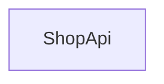

# Architecture

Projects of the solution and how they reference each other. The tables are generated; the text under each is for a person.

<!-- dblens:generated graph:projects gen=8bd24b9c -->

<!-- dblens:end -->

<!-- dblens:item project:ShopApi hash=fe5c4d54 gen=f4adc5a2 -->
### ShopApi

| SDK | Output | Framework | Project references | Packages | File |
| --- | --- | --- | --- | --- | --- |
| Microsoft.NET.Sdk.Web | Exe (sdk) | net10.0 | (none) | (none) | ShopApi.csproj |
<!-- dblens:slot project:ShopApi purpose max-lines=2 evidence=inferred hash=fe5c4d54 text=e8939786 -->
Web application exposing minimal-API endpoints to create, read and cancel orders, held in an in-memory OrderStore, plus a /health endpoint. It also hosts a background OutboxPublisher that polls an outbox and publishes pending messages to a message broker.
<!-- dblens:end -->
