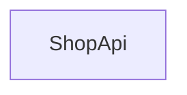

# Overview

How the solution is put together: its components, how they talk to each other, and the main flows. The diagrams and tables are generated from the code; the text under each is for a person.

<!-- dblens:generated graph:components gen=9b6e4a4e -->
## Components

<!-- dblens:end -->

<!-- dblens:item component:ShopApi hash=de4c42ec gen=6151025c -->
### ShopApi

| Role | Infrastructure | Private libraries | File |
| --- | --- | --- | --- |
| service | (none) | 0 | ShopApi.csproj |
<!-- dblens:slot component:ShopApi purpose max-lines=2 evidence=inferred hash=de4c42ec text=82f957f7 -->
Web application that exposes the shop's order endpoints and, in the background, publishes the messages waiting in the outbox to the message broker. It has no other component to talk to.
<!-- dblens:end -->
